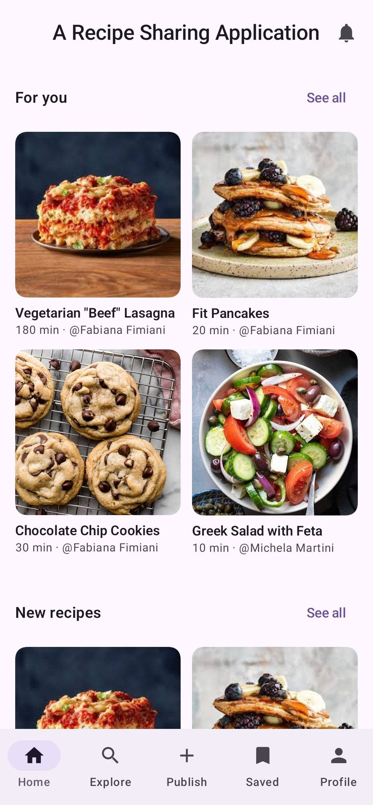
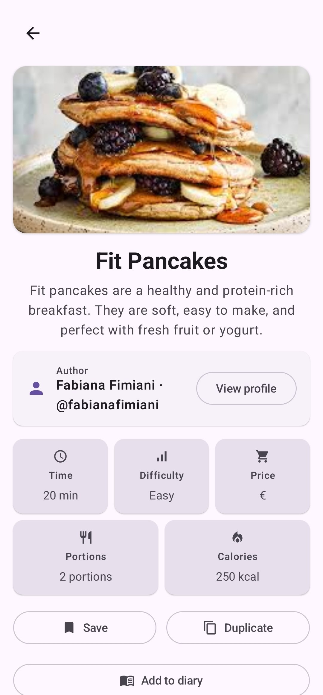
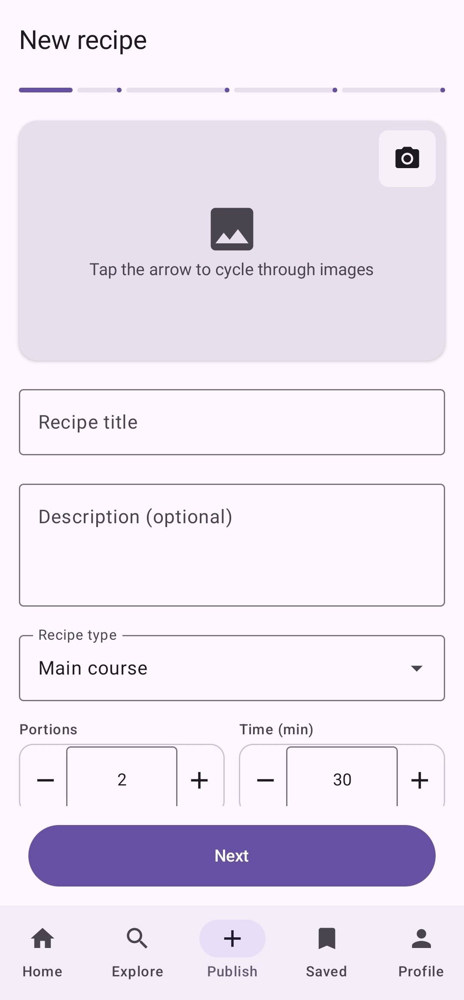
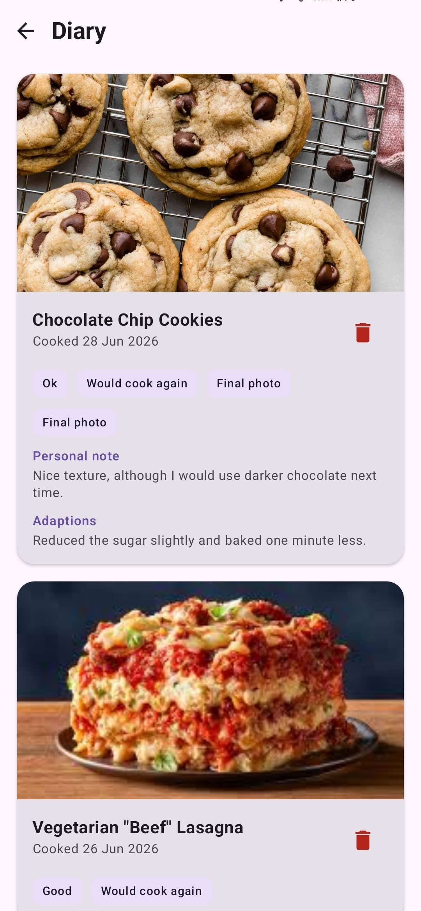
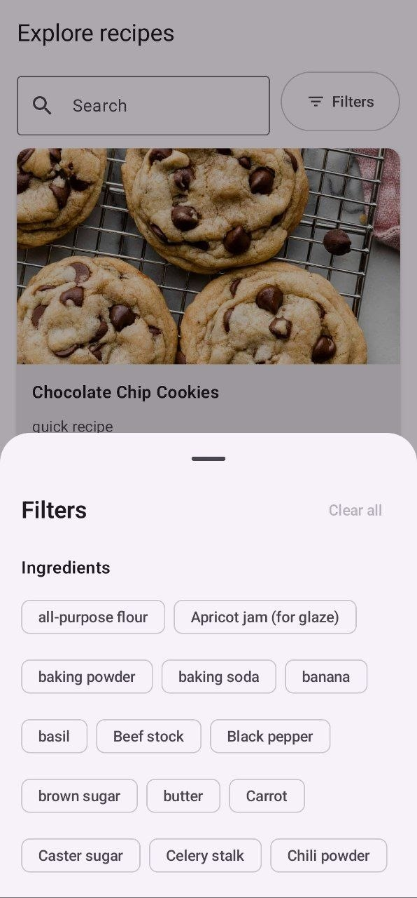
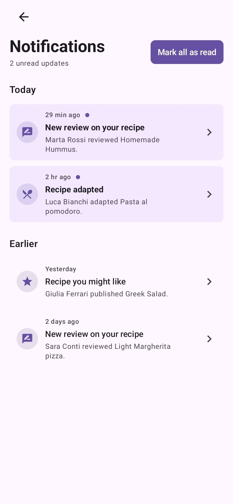

# CookBook Community


A community-driven recipe-sharing app for Android. Anyone can explore and filter recipes; signed-in users can publish, adapt, review and save them, keep a cooking diary, and get notified when the community interacts with their recipes.

Team project for *Mobile Application Development* at Politecnico di Torino (A.Y. 2025/26).

**[Download the latest APK](https://github.com/initram2002/cookbook-community/releases/latest)** (requires Android 14, API 34, or newer)

## Screenshots

| Home | Recipe detail | New recipe |
| :---: | :---: | :---: |
|  |  |  |
| **Cooking diary** | **Explore & Filters** | **Notifications** |
|  |  |  |

https://github.com/user-attachments/assets/24dae8ac-6357-4e75-9cae-368d81f85897

## Features

- **Explore & filter** community recipes, no account required
- **Publish recipes** with ingredients, step-by-step instructions, cooking details and a photo taken with the camera
- **Adapt a recipe**: create your own version of any recipe, which keeps a link to the original and credits its author
- **Ratings, reviews & tips**, with in-app notifications for recipe authors
- **Cooking diary**: log every recipe you cook, with the outcome, your modifications, personal notes and a photo of the result
- **Collections**: organize saved recipes into custom favorite collections
- **Rich profiles** with cooking role, favorite cuisines and dietary restrictions
- **Google Sign-In**: protected screens send you to login and then back to the section you were trying to reach

## Tech stack

| Area | Technologies |
| --- | --- |
| Language | Kotlin |
| UI | Jetpack Compose, Material 3, Coil |
| Architecture | MVI on Android ViewModel, Kotlin Coroutines, StateFlow |
| Navigation | Navigation Compose with type-safe `@Serializable` routes |
| Backend | Firebase Authentication (Google Sign-In via Credential Manager), Cloud Firestore |

## Architecture

The app follows an **MVI** (unidirectional data flow) approach:

- every screen renders a single immutable UI state, exposed by its ViewModel as a `StateFlow`;
- user actions are modeled as a sealed event hierarchy and handled by a single `onEvent()` entry point;
- ViewModels depend on **repository interfaces**, implemented on top of Firebase and wired through a lightweight manual DI container (`AppContainer`);
- Firestore queries are exposed as Kotlin `Flow`s via `snapshots()`, so the UI updates in real time;
- navigation is split into feature graphs (auth, home, recipes, profile, notifications), with **auth guards** on protected routes.

When the database is empty, the app seeds it with sample recipes, so the first experience is never a blank screen.

```text
app/src/main/java/it/polito/mad/cookbookcommunity/
├── data/         # repository interfaces, Firebase implementations, seed data
├── domain/       # use cases
├── model/        # domain models: recipes, reviews, profiles, collections…
├── navigation/   # type-safe routes, feature nav graphs, auth guards
├── session/      # session management
├── ui/           # Compose screens and reusable components
└── viewmodel/    # MVI ViewModels
```

Firestore collections: `users`, `recipes`, `reviews`, `tips`, `triedRecipes`, `favorites`, `favoriteCollections`, `notifications`.

## Build from source

1. Clone the repository and open it in a recent version of Android Studio (the Gradle daemon runs on JDK 21).
2. Run the `app` configuration on a device or emulator with Android 14 or newer.

The repository includes the Firebase configuration of the original project, where Google Sign-In only works for builds signed with a registered key. To run your own build, create a Firebase project, enable **Authentication → Google** and **Cloud Firestore**, register your signing key's SHA-1 and replace `app/google-services.json` with your own.

## My role

This was a highly collaborative project: instead of splitting the app by feature, the team worked on every layer together. Within that, my main focus areas were:

- **Navigation architecture & app shell**: type-safe routes organized into feature nav graphs (auth, home, recipes, profile), the root scaffold with bottom navigation, and the auth guard that sends users to login on protected screens and then back to the section they were trying to reach
- **Recipe detail flow**: the recipe screen and its owner/visitor actions (edit, delete, save, adapt)
- **Reviews, recipe creation and cooking diary**: the MVI ViewModels behind these features, plus the tried-recipes screen

## Team

Built by Group 04 for *Mobile Application Development* at Politecnico di Torino:

- Antonino Blancato ([@BlancatoAntonino](https://github.com/BlancatoAntonino))
- Fabiana Fimiani ([@FABIANA1211](https://github.com/FABIANA1211))
- Michela Martini ([@initram2002](https://github.com/initram2002))
- Mattia Riccardi ([@MattiaRiccardi](https://github.com/MattiaRiccardi))

[Project presentation (PDF)](presentation.pdf)
